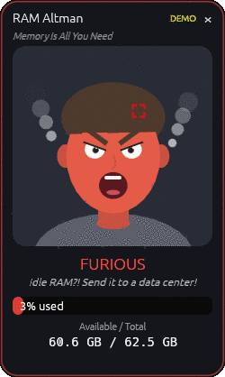
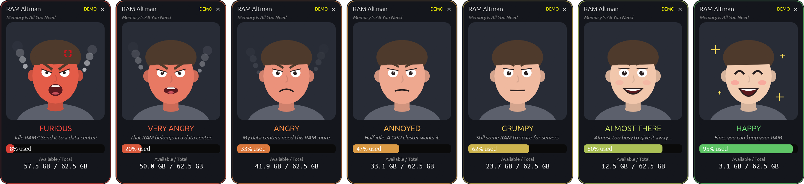

<p align="center"></p>

<h1 align="center">RAM Altman: Memory Is All You Need</h1>

<p align="center">
A tiny always-on-top desktop widget that shows your <b>Available / Total RAM</b><br>
and a cartoon Sam Altman who is <i>furious</i> about every gigabyte you leave unused.<br>
Idle consumer RAM, after all, would be much better off in a data center.
</p>

<p align="center"></p>

## Moods

He's only happy when at least **90%** of your RAM is in use.



| RAM used | Mood | He says |
|---|---|---|
| < 15% | FURIOUS | Idle RAM?! Send it to a data center! |
| 15–25% | VERY ANGRY | That RAM belongs in a data center. |
| 25–40% | ANGRY | My data centers need this RAM more. |
| 40–55% | ANNOYED | Half idle. A GPU cluster wants it. |
| 55–70% | GRUMPY | Still some RAM to spare for servers. |
| 70–90% | ALMOST THERE | Almost too busy to give it away… |
| ≥ 90% | HAPPY | Fine, you can keep your RAM. |

*(Screenshots were made with `--pct`, which is why they show a DEMO badge.)*

## Download & install

Grab the latest files from the [**Releases**](../../releases/latest) page.

### Windows

| File | What it is |
|---|---|
| `RAM-Altman-Setup-x.y.z.exe` | **Installer.** No admin rights needed. Adds a Start menu entry, an optional desktop shortcut, an optional "start with Windows" setting and an uninstaller. |
| `ram-altman-x.y.z-windows-x86_64-portable.exe` | **Portable.** Just double-click it, nothing gets installed. |

> Windows SmartScreen may warn about an unrecognized app because the exe isn't code-signed.
> Click **More info → Run anyway**.

### Linux (x86_64)

| File | How to install |
|---|---|
| `ram-altman_x.y.z_amd64.deb` | Debian / Ubuntu / Mint / Pop!_OS: `sudo apt install ./ram-altman_x.y.z_amd64.deb` (or double-click it) |
| `ram-altman-x.y.z-linux-x86_64.tar.gz` | Any distro: extract it, then run `./install.sh` (installs to `~/.local`, no root needed). Add `--autostart` to launch on login, or use `--uninstall` to remove it. |

After installing, launch **RAM Altman** from your app menu or run `ram-altman`.

To start it on login with the `.deb`: `cp /usr/share/applications/ram-altman.desktop ~/.config/autostart/`

## Using it

- **Move:** drag it anywhere.
- **Close:** use the × button, press `Esc`, or right-click → Close.
- **Options:**

  ```text
  ram-altman --zoom 1.5   # bigger (or smaller) widget, 0.5–4
  ram-altman --demo       # sweep 0→100% to preview every expression
  ram-altman --pct 10     # pretend 10% of RAM is used
  ```

"Used" means total RAM minus *available* RAM, which is the same number your OS task manager shows.

## Use your own pictures

The cartoon is drawn in code, so it's the same face every time and only the expression changes.
To use your own images, create a `faces` folder containing `level0.png` (furious) to `level6.png` (happy).
`.jpg` also works. Put the folder in one of these places:

- Linux: `~/.config/ram-altman/faces/`
- Windows: `%APPDATA%\ram-altman\faces\`
- next to the executable as `assets/faces/`, or anywhere else via the `RAM_ALTMAN_FACES_DIR` environment variable

Any level without an image falls back to the cartoon.

## Build from source

You need [Rust](https://rustup.rs) (stable).

```bash
cargo run --release            # run it
packaging/linux/package.sh     # Linux: build the .deb and .tar.gz into dist/
```

On Windows, `cargo build --release` produces `target\release\ram-altman.exe`.
The installer is built with [Inno Setup](https://jrsoftware.org/isinfo.php): `iscc /DAppVersion=0.1.0 packaging\windows\ram-altman.iss`.

## License

RAM Altman is free software, licensed under the [GNU General Public License v3.0 or later](LICENSE) (GPL-3.0-or-later).
You can use, study, share and modify it, and anything you distribute based on it must also be released under the GPL.

---

*Parody project, not affiliated with or endorsed by Sam Altman or OpenAI. The face is an original cartoon caricature.*
